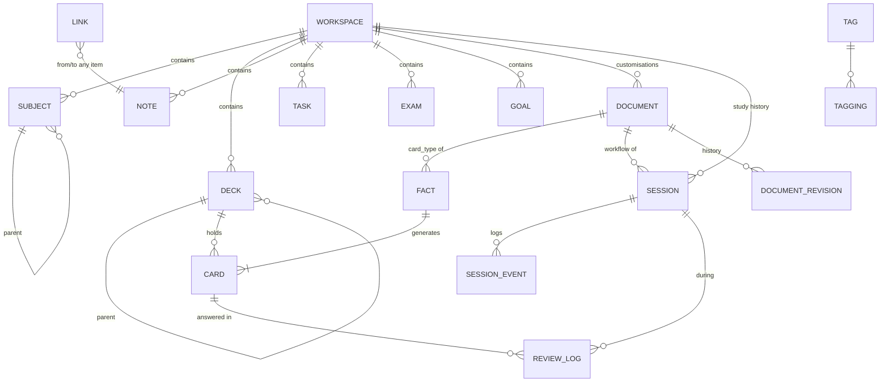

# 09 — Data Model, Query Language & Formats

> **Status:** Draft · **Version:** 0.1 · **Last updated:** 2026-11-19
> **Related:** [08-architecture](08-architecture.md) · [03-customization-model](03-customization-model.md) · [04-workflows](04-workflows.md) · decisions D-004, D-009

This is the conceptual model (entities, key fields, relationships). Exact column types and indexes will be defined in migrations. Naming: `snake_case`, singular entity names, plural table names.

## 1. Conventions

| Topic | Rule |
|---|---|
| Primary keys | UUIDv7 (time-sortable, generated on device), stored as 16-byte BLOB. Shown to users in lowercase Crockford base32 (26 chars); the **short id** is the last 8 characters (random bits). A prefix would not work, because UUIDv7 starts with the timestamp, so items created together share it (CLI-007). Built-in documents use string ids `builtin:<slug>`. |
| Timestamps | UTC, Unix milliseconds (`INTEGER`). |
| Study day | Local calendar date shifted by `srs.day_starts_at` (default 04:00), stored as `YYYY-MM-DD` where a "day" is needed (rollups, streaks). |
| Sync columns | On every syncable table: `created_at`, `updated_at`, `deleted_at` (tombstone), `hlc` (text, sortable), `origin_device` (D-009). |
| Deletes | Soft delete (`deleted_at`) → trash (WS-005) → purge after retention. Synced tombstones are kept. |
| Flexible data | JSON in `TEXT` columns (documents, field values, step config), always validated by the core. |
| Append-only | `review_logs`, `session_events`, `goal_checkins`, `oplog`: never updated in place. |
| Workspace scoping | Content tables carry `workspace_id`. Global documents have `workspace_id = NULL`. |

## 2. Entity overview



## 3. Entities

### Organisation

| Entity | Key fields | Notes |
|---|---|---|
| `profile` | id, display_name, created_at | One per data dir in v1 (multiple profiles: OQ-014). Maps to a sync account in Phase 2. |
| `device` | id, name, platform, created_at, last_seen_at | This device's row is created on first open. |
| `workspace` | id, name, icon, color, sort, archived_at | WS-001 |
| `subject` | id, workspace_id, parent_id, name, color, icon, sort, archived_at | Tree (WS-002) |
| `tag` | id, workspace_id, path (`bio::cells`), path_key, color | Hierarchy by path prefix (WS-003); parents need no row. Matched case-insensitively through `path_key` (Unicode lower case, unique per workspace), like Anki; the first spelling is kept. No spaces inside a tag. Migration 0005. |
| `tagging` | id, tag_id, item_kind, item_id | Polymorphic join (`item_kind` is checked in the core, so new kinds need no migration). Has its own id for the change log and sync (D-009). Migration 0005. |
| `link` | id, from_kind, from_id, to_kind, to_id, rel (`references` · `generated_from` · `reflection_of` · `attachment`) | Backlinks, provenance |
| `custom_property` (P1) | id, workspace_id, applies_to, name, type, options | WS-007; values in the item's `props` JSON |

### Flashcards

| Entity | Key fields | Notes |
|---|---|---|
| `deck` | id, workspace_id, parent_id, subject_id?, name, options_id (→ `deck_options` document), sort | SRS-001. Addressed by path `Parent::Child`; sibling names are unique. `subject_id` lands with subjects (WS-002). |
| `fact` | id, workspace_id, card_type_id (→ `card_type` document), card_type_rev, deck_id, fields (JSON map), sort_field, checksum, props, source | The field values. Called a "note" in Anki; renamed to avoid clashing with Notes. Implemented in migration 0002 with the built-in card type id; `card_type_rev` is added with editable card types (SRS-013, P1). `source` (migration 0004) records provenance, e.g. `anki:<note guid>`, for idempotent re-import. |
| `card` | id, fact_id, template_ord, deck_id, state (`new`/`learning`/`review`/`relearning`), due, stability, difficulty, reps, lapses, last_review_at, suspended, buried_until, flag | Scheduling columns are a **cache** derivable from `review_logs` (SRS-006). |
| `review_log` | id, card_id, session_id?, reviewed_at, rating (1–4), elapsed_ms, state_before, stability/difficulty before/after, scheduled_days, scheduler (`fsrs@x.y`), device_id | Append-only; also stores the FSRS-7 fast-stability trace before and after (`stability_fast_*`), the interval and the resulting due time (migration 0003) |

### Knowledge & resources

| Entity | Key fields | Notes |
|---|---|---|
| `note` | id, workspace_id, subject_id?, title, body_md, pinned, template_id?, props | NOTE-001; FTS-indexed |
| `note_revision` (P1) | id, note_id, body_md, saved_at | NOTE-007 |
| `resource` | id, workspace_id, kind (`file` / `link`), title, uri or media_hash, mime, size | RES-001 |
| `media` | hash (PK), ext, mime, size, created_at | Content-addressed files on disk (`media/ab/cd/<hash>.<ext>`, D-026); `hash` is lowercase hex SHA-256. Immutable and device-independent, so it has no sync columns: sync moves the files by hash. Migration 0006. |
| `media_name` | id, workspace_id, name, hash (→ `media`) | What fields mean by a media name (``, `[sound:x.mp3]`), per workspace (D-026). Unique live name per workspace. Synced. Migration 0006. |

### Planning & goals

| Entity | Key fields | Notes |
|---|---|---|
| `task` | id, workspace_id, subject_id?, parent_id?, kind (`task` / `assignment`), title, body_md, status, priority, due_at, estimate_min, recurrence (RRULE subset), completed_at, grade?, checklist (JSON), props | PLAN-001/002/005 |
| `exam` | id, workspace_id, title, starts_at, location, scope (query), target_score, notes_md, props | PLAN-002; `scope` links decks/subjects via query |
| `goal` | id, workspace_id, title, metric, target, period (`day`/`week`/`month`/`by_date`), scope (query), starts_on, ends_on, streak_rules (JSON), active | GOAL-001 |
| `goal_checkin` (P1) | id, goal_id, study_day, value | Manual habits; append-only |
| `reminder` (P1) | id, workspace_id, kind, target_kind, target_id, rule (JSON), enabled, next_fire_at | NOTIF-002, WF-009 |

### Study runtime

| Entity | Key fields | Notes |
|---|---|---|
| `session` | id, workspace_id, workflow_id, workflow_snapshot (JSON), params (JSON), status, started_at, ended_at, active_ms, paused_ms, current_step_path, subject_id?, task_id?, summary (JSON), revision, heartbeat_at, manual (bool) | [04 §5](04-workflows.md#5-runtime-semantics). `manual = true` for logged sessions (SES-007). |
| `session_event` | id, session_id, at, type (`step_started` · `step_completed` · `step_skipped` · `paused` · `resumed` · `extended` · `ended` …), step_path, data (JSON) | Append-only |

### Customisation

| Entity | Key fields | Notes |
|---|---|---|
| `document` | id, workspace_id?, kind, schema, name, body (JSON), based_on?, revision, is_builtin_shadow | [03 §7](03-customization-model.md#7-document-format). Built-ins are embedded in the binary, not stored; a fork is stored with the built-in's id in `based_on`. |
| `document_revision` (P1) | id, document_id, revision, body, saved_at, device_id | CUST-010 (last 20) |
| `preset_install` | id, workspace_id, preset_id, preset_version, applied_at, components (JSON) | Enables *Re-apply preset* and update notices |
| `setting` | scope (`app` / `workspace` / `device`), scope_id, key, value (JSON) | Layered resolution ([03 §5](03-customization-model.md#5-settings-layering)). Device rows never sync. |

### System & derived

| Entity | Key fields | Notes |
|---|---|---|
| `oplog` | seq (PK, autoincrement), hlc, device_id, entity, entity_id, op (`insert`/`update`/`delete`), fields (JSON), synced_at? | Local change feed ([08 §8](08-architecture.md#8-multi-process-access-desktop--cli)) and future sync log. Compacted when sync is off. |
| `daily_stats` | workspace_id, study_day, subject_id?, deck_id?, metric, value | Incremental rollups (STAT-004); rebuildable from source tables |
| `fts_*` | FTS5 virtual tables over fact fields, notes, tasks, exams, resources | SRCH-001 |
| `schema_meta` | key, value | App version that last migrated, etc. |

## 4. Card types (built-in)

Card types are documents (`kind = "card_type"`). Templates use the logic-less syntax from SRS-013.

| ID | Fields | Cards generated |
|---|---|---|
| `builtin:basic` | Front, Back | Front → Back |
| `builtin:basic-reverse` | Front, Back | Front → Back, Back → Front |
| `builtin:optional-reverse` | Front, Back, Add Reverse | Reverse only if *Add Reverse* is non-empty |
| `builtin:cloze` | Text, Extra | One card per cloze number `{{c1::…}}` |
| `builtin:type-in` | Front, Back | Front → typed answer compared with Back |

Changing a card type's fields (P1) runs a core-managed migration of affected facts (rename / drop / add field, with confirmation).

## 5. Derived data and invariants

- `card` scheduling columns == replay of the card's `review_logs` with its scheduler. `addisco doctor --fix` can rebuild them.
- `daily_stats` == aggregate of `review_logs`, `session_events` and `tasks`. Rebuildable.
- FTS tables are kept in sync by triggers and rebuildable.
- Every write path goes through `core-api` commands, which append to `oplog` in the same transaction.

## 6. Query language

One syntax for search, card browser, filtered review, workflow steps, widgets, goals, exams and saved views (SRCH-003). Parsed in core → AST → parameterised SQL. Never string-concatenated SQL.

### Syntax

```
query      := clause ( [ "OR" ] clause )*        # adjacency = AND
clause     := [ "-" ] ( term | "(" query ")" )
term       := key ":" value | "\"phrase\"" | word
value      := word | "\"quoted value\"" | comparison
comparison := ( "<" | "<=" | ">" | ">=" | "=" ) number-or-date-or-duration
```

### Keys (P0 unless marked)

| Key | Example | Meaning |
|---|---|---|
| `deck:` | `deck:Biology`, `deck:"Organic Chem"` | Deck and its subdecks (`deck:Biology/` = exact, no subdecks) |
| `subject:` | `subject:Physics` | Subject and its children |
| `tag:` | `tag:exam`, `tag:bio::cells` | Tag and its descendants |
| `type:` | `type:card` · `note` · `task` · `exam` · `resource` | Item kind (search contexts) |
| `is:` | `is:due` · `new` · `learning` · `review` · `suspended` · `buried` · `flagged` · `overdue` · `open` · `done` · `pinned` | State filters (by item kind) |
| `due:` | `due:<=0`, `due:<3d` | Due relative to today (cards, tasks) |
| `created:` / `updated:` | `created:>2026-09-01`, `updated:<7d` | Dates or relative durations |
| `rated:` | `rated:1` (today), `rated:7d:1` (rated *Again* in last 7 days) | Review history |
| `lapses:` / `reps:` | `lapses:>3` | Card counters |
| `priority:` | `priority:high` | Tasks |
| `card_type:` | `card_type:cloze` | Facts/cards |
| `field:` (P1) | `field:Front:*mitochond*` | Field-specific match |
| `prop:` (P1) | `prop:difficulty>=3` | Custom properties |
| text | `mitochondria`, `"cell membrane"` | Full-text (FTS5) |

Examples: `deck:Biology is:due -tag:skip` · `tag:exam (is:due OR rated:7d:1)` · `type:task is:open due:<7d subject:Chem`.

Errors are reported with a position and a suggestion (CLI exit `4`; inline in the UI).

## 7. Export archive format (`.addiscoarchive`)

A ZIP file with a documented, versioned layout (IO-003). It round-trips everything except device-scoped settings.

```
manifest.json                 # format version, app version, created_at, profile, counts, checksums
data/
  workspaces.ndjson
  subjects.ndjson  tags.ndjson  taggings.ndjson  links.ndjson
  decks.ndjson  facts.ndjson  cards.ndjson  review_logs.ndjson
  notes.ndjson  resources.ndjson
  tasks.ndjson  exams.ndjson  goals.ndjson  goal_checkins.ndjson
  sessions.ndjson  session_events.ndjson
  settings.ndjson  preset_installs.ndjson
documents/                    # customisation documents as TOML (human-readable)
  workflows/*.toml  dashboards/*.toml  card_types/*.toml  deck_options/*.toml  …
notes/                        # notes also as Markdown with front-matter (convenience copy)
media/<sha256>.<ext>
```

Imports validate checksums and schema versions, and migrate older archive formats forward.

## 8. On-disk layout

```
<data_dir>/
├── study.db  (+ study.db-wal, study.db-shm)
├── media/ab/cd/<sha256>.<ext>
├── backups/<timestamp>.db.zst  (+ media manifest)
├── logs/
└── device.toml              # device id, device-scoped settings cache
<config_dir>/
└── cli.toml                 # CLI config (06 §7)
```

| OS | `data_dir` | `config_dir` |
|---|---|---|
| Linux | `$XDG_DATA_HOME/addisco` (`~/.local/share/addisco`) | `$XDG_CONFIG_HOME/addisco` (`~/.config/addisco`) |
| macOS | `~/Library/Application Support/Addisco` | same; the CLI also honours `~/.config/addisco/cli.toml` if present |
| Windows | `%LOCALAPPDATA%\Addisco` | `%APPDATA%\Addisco` |

`ADDISCO_DATA_DIR` / `--data-dir` and `ADDISCO_CONFIG` / `--config` override these (portable installs, tests).

## 9. Migration policy

- Forward-only numbered migrations in core. Each one is tested against fixture databases from every released schema version.
- An automatic backup is taken before any migration. A failed migration rolls back and leaves the DB untouched.
- Document schema migrations (per kind) are separate from DB migrations and are applied on read/import ([03 §7](03-customization-model.md#7-document-format)).
